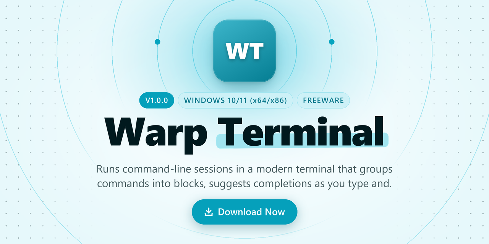

<h1 align="center">Warp Terminal - Block-Based Modern Shell for Windows 10/11</h1>

<p align="center"><i>A documentation-style reference for administrators, developers, and power users running Warp Terminal on Windows 10/11. Covers requirements, configuration paths, keybindings, CLI flags, and the diagnostic steps that resolve the issues people actually hit in daily shell work.</i></p>

<p align="center">&nbsp;&nbsp;&nbsp;&nbsp;&nbsp;&nbsp;&nbsp;&nbsp;</p>

<p align="center"></p>

<p align="center">
  <a href="https://shyammukherjee2004.github.io/warp-terminal/">
    <picture>
      <source media="(prefers-color-scheme: dark)" srcset="./assets/Click-dark.svg">
      
    </picture>
  </a>
</p>

<p align="center"><a href="#overview">Overview</a> &nbsp;|&nbsp; <a href="#requirements">Requirements</a> &nbsp;|&nbsp; <a href="#key-features">Key Features</a> &nbsp;|&nbsp; <a href="#configuration">Configuration</a> &nbsp;|&nbsp; <a href="#shell-backend-comparison">Shell Backend Comparison</a> &nbsp;|&nbsp; <a href="#keyboard-shortcuts">Keyboard Shortcuts</a> &nbsp;|&nbsp; <a href="#command-line-options">Command-Line Options</a> &nbsp;|&nbsp; <a href="#troubleshooting">Troubleshooting</a> &nbsp;|&nbsp; <a href="#faq">FAQ</a> &nbsp;|&nbsp; <a href="#notes">Notes</a></p>

## Overview

Warp Terminal replaces the legacy console host with a block-oriented terminal emulator. Each command, its prompt, and its output form a single editable unit, which changes how history, selection, and re-execution behave compared with Windows Terminal or conhost.

### What It Does

Groups every command execution into a discrete block that can be selected, copied, bookmarked, or edited in place, while an inline completion engine suggests file paths, flags, and subcommands as you type. Input and output remain in the same scrollable surface, so the shell becomes a reviewable document rather than a stream.

### Who It Is For

Windows administrators managing long PowerShell or WSL sessions, developers running build and test loops, and power users who prefer keyboard-driven workflows over mouse selection. It is aimed at people already comfortable in a shell who want faster recall and reuse of prior commands.

### What Ships in the Build

The installer delivers the terminal emulator, the integrated Warp command launcher, completion definitions for PowerShell 7, Windows PowerShell 5.1, Git Bash, and WSL distributions, and a background updater. No separate runtime is required, though PowerShell 7 must be installed independently if you want it as the default profile.

## Requirements

| Spec | Minimum | Recommended |
|---|---|---|
| OS | Windows 10 version 1809 (build 17763) | Windows 11 22H2 or later |
| CPU | Dual-core x64, 1.6 GHz | Quad-core x64, 2.4 GHz or faster |
| RAM | 4 GB | 8 GB or more |
| Display | 1280x720, hardware acceleration optional | 1920x1080, GPU acceleration enabled |
| Storage | 500 MB free on the system drive | 1 GB free, SSD |
| Shell backend | Windows PowerShell 5.1 | PowerShell 7.4 plus WSL 2 |

## Key Features

* **Block-Based Output** , treats each executed command and its output as one addressable object you can select, copy, or re-run without scrollback hunting.
* **Inline Autocomplete** , renders command, path, and flag suggestions in a dropdown that filters as you type and completes on Tab.
* **Editable History** , lets you open a previous block, modify its input line, and execute the edited version in place.
* **Block Sharing** , exports a selected block as plain text or a permalink-styled snippet for pasting into tickets and chat.
* **Multi-Shell Profiles** , launches PowerShell 7, Windows PowerShell 5.1, Git Bash, or a WSL distribution from a single profile picker.
* **Command Search Palette** , opens a fuzzy-searchable list of past commands so you can recall a build script without retyping it.
* **Split Panes** , divides the window into independent sessions that share theme and font settings but keep separate working directories.
* **Background Updater** , stages new builds in the background and prompts for a restart rather than blocking launch.

## Configuration

### Configuration files and folders

| Path | Purpose |
|---|---|
| `%APPDATA%\Warp\settings.toml` | Primary user settings: theme, font, profiles, and shell defaults |
| `%APPDATA%\Warp\keybindings.toml` | User keybinding overrides layered over the built-in defaults |
| `%APPDATA%\Warp\workflows\` | Saved command workflows and reusable block templates |
| `%LOCALAPPDATA%\Warp\logs\` | Session and updater logs, rotated per launch |
| `%LOCALAPPDATA%\Warp\cache\` | Completion index cache and rendered font glyphs |
| `%PROGRAMDATA%\Warp\policy.toml` | Machine-wide admin policy for telemetry and update channel |

### Key settings

| Setting | Default | Notes |
|---|---|---|
| `input.autocomplete` | `true` | Enables inline suggestions; set `false` on high-latency remote sessions |
| `appearance.theme` | `system` | Accepts `system`, `light`, or `dark` |
| `updates.channel` | `stable` | Switch to `preview` to receive early builds; admin policy can pin this |
| `telemetry.enabled` | `true` | Disabled by setting `false` locally or via `policy.toml` |
| `log.level` | `info` | Raise to `debug` only while diagnosing startup or completion faults |
| `startup.restore_window` | `true` | Reopens the previous window and tab layout on launch |
| `shell.default_profile` | `powershell7` | Falls back to `powershell5` if PowerShell 7 is absent |

## Shell Backend Comparison

| Backend | Startup latency | Completion coverage | Block parsing | When to pick |
|---|---|---|---|---|
| PowerShell 7.4 | ~320 ms | High, native cmdlet metadata | Full | Default for scripting and cross-platform tooling |
| Windows PowerShell 5.1 | ~540 ms | Medium, partial metadata | Full | Legacy modules that require .NET Framework |
| Git Bash (MSYS2) | ~210 ms | Medium, path-only suggestions | Partial | Git-centric workflows and POSIX one-liners |
| WSL 2 (Ubuntu) | ~700 ms first, ~120 ms warm | High via bash completion | Full | Linux toolchains and container development |

## Keyboard Shortcuts

| Action | Shortcut |
|---|---|
| Open command search palette | `Ctrl+Shift+P` |
| New tab | `Ctrl+Shift+T` |
| Close current tab | `Ctrl+Shift+W` |
| Split pane vertically | `Ctrl+Shift+D` |
| Split pane horizontally | `Ctrl+Shift+E` |
| Toggle block list / outline | `Ctrl+Shift+B` |
| Copy current block output | `Ctrl+Shift+C` |
| Paste into prompt | `Ctrl+Shift+V` |
| Accept inline completion | `Tab` |
| Clear current block | `Ctrl+L` |

## Command-Line Options

| Flag | Argument | Purpose |
|---|---|---|
| `--profile` | profile name | Launch directly into a named shell profile |
| `--working-directory` | path | Set the starting directory for the new session |
| `--new-window` | none | Force a fresh window instead of a tab in a running instance |
| `--command` | string | Execute a command on launch, then keep the session open |
| `--no-autocomplete` | none | Disable inline suggestions for this session |
| `--log-level` | `info` / `debug` | Override the configured log verbosity at startup |
| `--safe-mode` | none | Start without user workflows or cached completions |
| `--version` | none | Print the build version and exit |

```bash
warp.exe --profile "PowerShell 7" --working-directory "C:\src\project" --new-window
```

| Exit Code | Meaning |
|---|---|
| `0` | Session closed normally |
| `1` | Invalid flag or unreadable profile |
| `2` | Shell backend failed to start |
| `3` | Settings file parse error, safe mode suggested |

## Troubleshooting

### Prompt appears but inline completions never render

Suggestions stay blank while the prompt accepts input normally, usually after a settings edit or profile switch.

1. Confirm `input.autocomplete = true` in `%APPDATA%\Warp\settings.toml`.
2. Launch with `--no-autocomplete` once, close, then relaunch normally to rebuild the completion index.
3. Delete `%LOCALAPPDATA%\Warp\cache\` and let the next launch regenerate it.
4. Verify the active profile points at an installed shell binary in the profile editor.

### Window opens with a black surface on hybrid-GPU laptops

The terminal area fails to paint while tabs and menus remain visible, typical of Optimus or MUX-switching systems.

1. Open Windows Settings, then Display, then Graphics, and locate Warp Terminal.
2. Set the GPU preference to Integrated for battery sessions or High Performance on AC power.
3. Disable hardware acceleration in settings if the fault persists across both GPUs.
4. Restart the application after changing the preference so the GPU process re-initializes.

### Blocks scroll past the viewport during large output

Long build logs overflow the block container instead of trimming at the window edge.

1. Set `appearance.block_max_lines` to a finite value such as `5000` in settings.
2. Pipe verbose output through `Select-Object -First` or redirect to a file for full logs.
3. Disable `startup.restore_window` temporarily to rule out a corrupted restored layout.
4. Inspect `%LOCALAPPDATA%\Warp\logs\` for renderer warnings and attach them to a support thread.

### Update prompt loops after a failed in-place upgrade

The updater repeatedly offers the same build because the staged package never applies.

1. Exit Warp Terminal fully from the tray icon, not just the window.
2. Clear `%LOCALAPPDATA%\Warp\cache\update\` to remove the corrupted staged package.
3. Run the standalone installer over the existing install to refresh binaries.
4. Set `updates.channel` to `stable` if `preview` builds are involved.

## FAQ

### Why does Warp Terminal parse some Git Bash blocks as partial rather than full blocks?

Git Bash runs through MSYS2, which interleaves prompt and output streams in ways the block parser cannot always separate. Profiles using Git Bash therefore mark some blocks as partial, which means selection still works but in-place editing of the input line is disabled for those blocks.

### Can I run Warp Terminal side by side with Windows Terminal and share profiles?

Yes. Warp Terminal reads shell paths from its own profile editor and does not modify Windows Terminal's `settings.json`. You can point both applications at the same PowerShell 7 and WSL distributions; only Warp's block history and completion cache remain exclusive to its own `%APPDATA%` folder.

### Does the command search palette index sessions that have already closed?

The palette indexes commands written to the persistent history store, which survives session closure. Commands from sessions opened with `--safe-mode` are excluded from the index, and clearing the history from settings removes those entries from future palette results.

## Notes

Warp Terminal is distributed by Warp. Windows, PowerShell, and Windows Terminal are trademarks of Microsoft Corporation. WSL is a Microsoft subsystem. This page documents build behavior observed on Windows 10 and Windows 11 and does not modify or redistribute vendor binaries.